# NaiveBias-CrushTest

Когда наивный байесовский классификатор (NB) «ломается» из-за коррелированных признаков? Синтетический стресс-тест: гауссовский NB против QDA (полная ковариация у каждого класса) на двух гауссовских классах.

## Вопрос и главный вывод

NB предполагает независимость признаков. Что происходит, когда они сильно коррелируют, и когда QDA, учитывающий корреляции, реально выигрывает?

**Главный вывод.** Сама по себе корреляция признаков не делает NB плохим. NB теряет в точности ровно ту часть различия между классами, которая «спрятана» в зависимостях между признаками:

- если центры классов сдвинуты **вдоль оси эллипса рассеяния** (вдоль собственного вектора $`\Sigma`$), NB при большой выборке не уступает QDA, а на малой выигрывает у него;
- если сдвиг идёт **наискосок к осям эллипса**, NB проигрывает QDA до 0.24–0.30 по accuracy, и этот проигрыш не исчезает с ростом выборки;
- если классы различаются **только** ковариациями (одинаковые средние и дисперсии), NB остаётся на уровне случайного угадывания ($`\approx 0.5`$), а QDA достигает 0.85–0.98.

При малых выборках картина обратная: гибкая модель (QDA) платит за оценку ковариаций и проигрывает простой.

## Что такое «сдвиг», «направление» и угол θ

Центры двух классов стоят в точках $`+\mathbf m`$ и $`-\mathbf m`$. Стрелка между ними и есть «сдвиг». У неё два свойства:

- **длина** $`s=\lVert\mathbf m\rVert`$ — расстояние от начала координат до центра каждого класса (в скриптах `sh_g`); расстояние между центрами равно $`2s`$;
- **направление** — единичный вектор $`\mathbf d=\mathbf m/s`$, то есть куда смотрит стрелка.

Если признаки коррелируют, облако каждого класса — вытянутый эллипс. Его оси — собственные векторы матрицы $`\Sigma`$, то есть направления, вдоль которых $`\Sigma`$ вектор только растягивает или сжимает и не поворачивает. Для равнокоррелированной $`\Sigma`$ (все внедиагональные элементы равны $`\rho`$) длинная ось — это $`\mathbf u=\tfrac{1}{\sqrt D}(1,\dots,1)`$ (собственное значение $`1+(D-1)\rho`$), а все направления, перпендикулярные $`\mathbf u`$, — короткие оси (собственное значение $`1-\rho`$). Пример для $`D=2`$, $`\rho=0.9`$:

```math
\Sigma\begin{pmatrix}1\\1\end{pmatrix}=1.9\begin{pmatrix}1\\1\end{pmatrix},\qquad
\Sigma\begin{pmatrix}1\\-1\end{pmatrix}=0.1\begin{pmatrix}1\\-1\end{pmatrix},\qquad
\Sigma\begin{pmatrix}1\\0\end{pmatrix}=\begin{pmatrix}1\\0.9\end{pmatrix}.
```

Первые два вектора $`\Sigma`$ только растягивает (это оси эллипса), третий она поворачивает к диагонали (это не ось).

В угловых экспериментах направление задаётся одним углом $`\theta`$:

```math
\mathbf d(\theta)=\cos\theta\,\mathbf u+\sin\theta\,\mathbf v,\qquad
\mathbf v=\tfrac{1}{\sqrt 2}(1,-1,0,\dots,0)\perp\mathbf u .
```

$`\theta`$ — это угол между направлением сдвига и длинной осью $`\mathbf u`$ (а не осью $`x_1`$). При $`\theta=0^\circ`$ центры разведены вдоль длинной оси, при $`\theta=90^\circ`$ — поперёк неё, между ними — наклонные направления. При $`D=2`$ угол $`\theta=45^\circ`$ даёт $`\mathbf d=(1,0)`$, то есть сдвиг только по $`x_1`$.

Если сдвиг лежит вдоль оси эллипса, NB при больших $`n`$ ничего не теряет. Если сдвиг идёт наискосок к осям, NB проигрывает. Количественно это показано в разделах «Результаты» и «Теория».

## Постановка

- **Данные.** Два класса $`\mathcal N(\boldsymbol\mu_1,\Sigma_1)`$ и $`\mathcal N(\boldsymbol\mu_2,\Sigma_2)`$, метки 0 и 1, классы сбалансированы.
- **Классификаторы** (реализованы на numpy, без sklearn):
  - NB — гауссовский: по каждому признаку отдельно оцениваются среднее и дисперсия, плотности перемножаются;
  - QDA — среднее и полная ковариация на класс, логарифм плотности плюс логарифм приора.
- **Матрицы ковариации.**
  - Равнокоррелированная: $`\Sigma_{ii}=1`$, $`\Sigma_{ij}=\rho`$ при $`i\neq j`$.
  - Тёплица: $`\Sigma_{ij}=\rho^{\lvert i-j\rvert}`$.
  - Для случая «разные ковариации»: класс 1 имеет $`\rho^{\lvert i-j\rvert}`$, класс 2 имеет $`(-\rho)^{\lvert i-j\rvert}`$ (знаки связей чередуются).
- **Сетка.** Размерность $`D\in\{2,4,6,8\}`$; размер выборки $`n\in\{50,100,200,400,800,1600,3200\}`$ точек на класс (80% идёт в обучение, 20% в тест); $`\rho`$ от 0 до 0.9 с шагом 0.1; 20 сидов.

**Метрика.** Accuracy на тесте. Для каждого сида считается разность $`\Delta_s=\mathrm{acc}^{\mathrm{QDA}}_s-\mathrm{acc}^{\mathrm{NB}}_s`$, на графиках показано её среднее по сидам и стандартная ошибка:

```math
\bar\Delta=\frac1N\sum_{s=1}^{N}\Delta_s,\qquad
\mathrm{SE}=\frac{\operatorname{std}(\Delta_s;\ \mathrm{ddof}=1)}{\sqrt N},\qquad N=20 .
```

Здесь $`N`$ — число сидов, а не число точек. SE показывает, насколько среднее по сидам могло бы отличаться из-за случайности данных; это не ошибка классификатора (она равна $`1-\mathrm{acc}`$). На графиках закрашена полоса $`\pm 2\,\mathrm{SE}`$; на тепловых картах точками отмечены клетки, где $`\lvert\bar\Delta\rvert<2\,\mathrm{SE}`$, то есть разница неотличима от нуля.

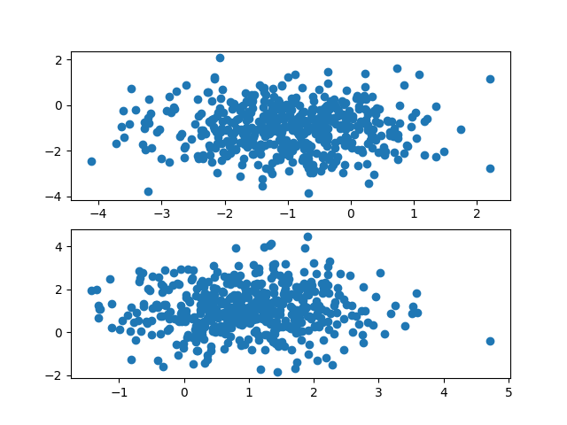

*Пример данных при $`D=2`$: облака двух классов (каждое на своей панели), центры расположены симметрично вдоль диагонали.*

## Результаты

### 1. Базовая геометрия: центры $`\pm m\,\mathbf 1`$, равные $`\rho`$

**Условия.** Центры классов $`\pm m\,\mathbf 1`$, где $`\mathbf 1=(1,\dots,1)`$ и $`m`$ от 0 до 0.9; $`\Sigma`$ равнокоррелированная. Сдвиг идёт вдоль длинной оси, то есть $`\theta=0^\circ`$.

**Результат.** QDA практически нигде не выигрывает у NB: $`\mathrm{QDA}-\mathrm{NB}\le 0`$ в пределах шума. На выборке $`n=800`$ на класс (так указано в журнале) проигрыш QDA достигает $`-0.025`$ ($`D=6`$), при $`n=50`$ — до $`-0.12`$, при $`n\ge 1600`$ разница около нуля (не хуже $`-0.01`$). Проигрыш растёт с размерностью и дольше держится при высокой корреляции.

**Объяснение.** При $`n\to\infty`$ это согласуется с теорией: сдвиг вдоль $`(1,\dots,1)`$ идёт вдоль собственного направления $`\Sigma`$, поэтому разрыв равен нулю (см. «Теория»). Проигрыш на малых $`n`$, по-видимому, является ценой оценки ковариаций у QDA.

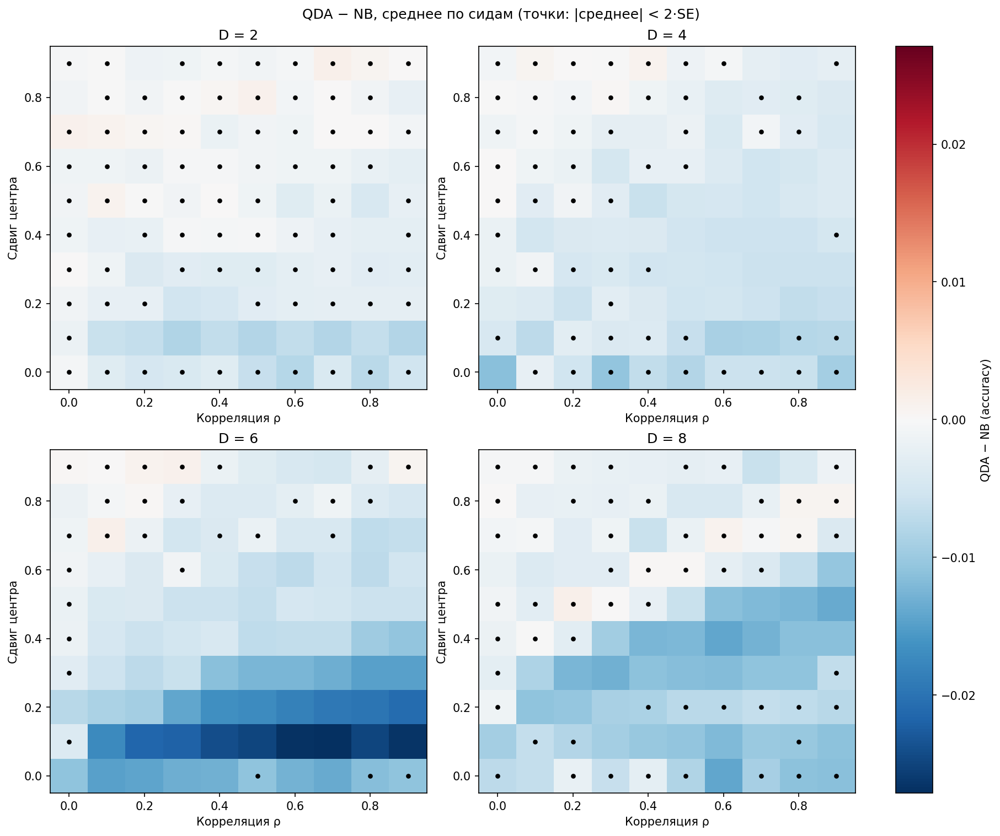

*$`\mathrm{QDA}-\mathrm{NB}`$ при $`n=800`$: по горизонтали $`\rho`$, по вертикали сдвиг центра $`m`$, панели — $`D=2,4,6,8`$. Точки — клетки, где $`\lvert\bar\Delta\rvert<2\,\mathrm{SE}`$.*

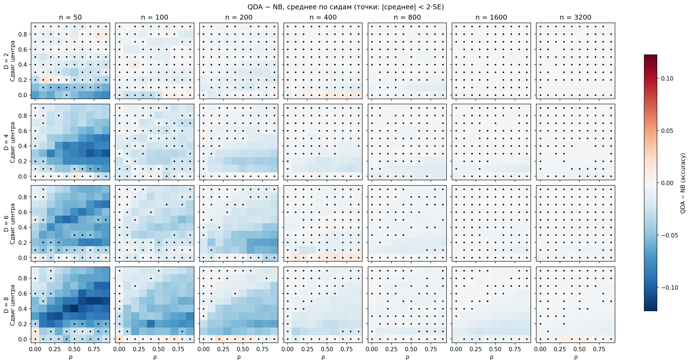

*То же для всех $`n`$ (столбцы) и $`D`$ (строки), шкала цвета общая. С ростом $`n`$ синие области исчезают.*

Accuracy каждого классификатора по отдельности (один сид; оси подписаны индексами 0–9):

<p align="center">
  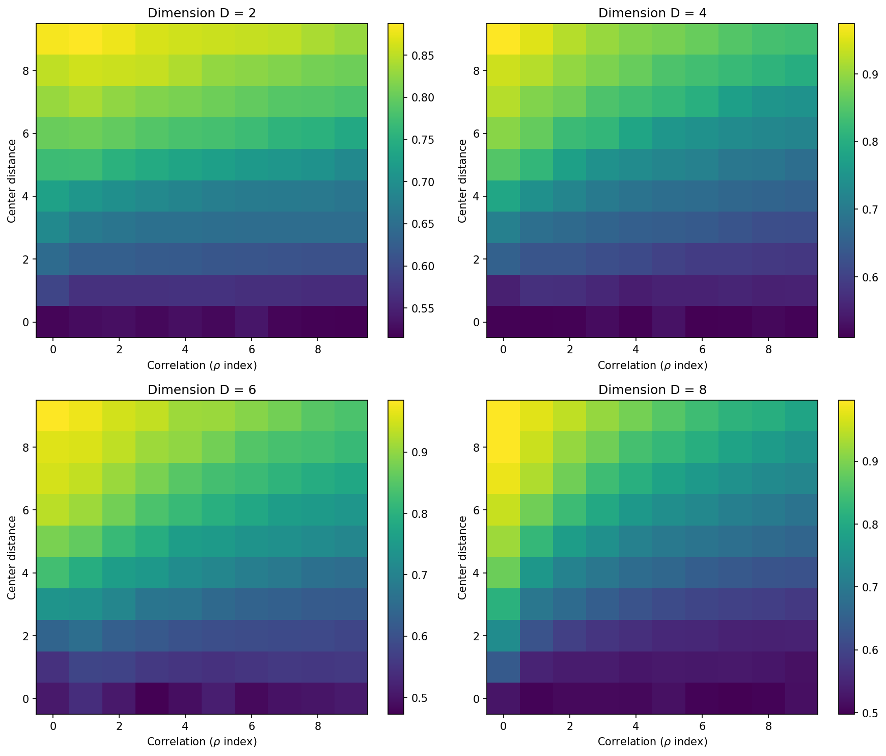
  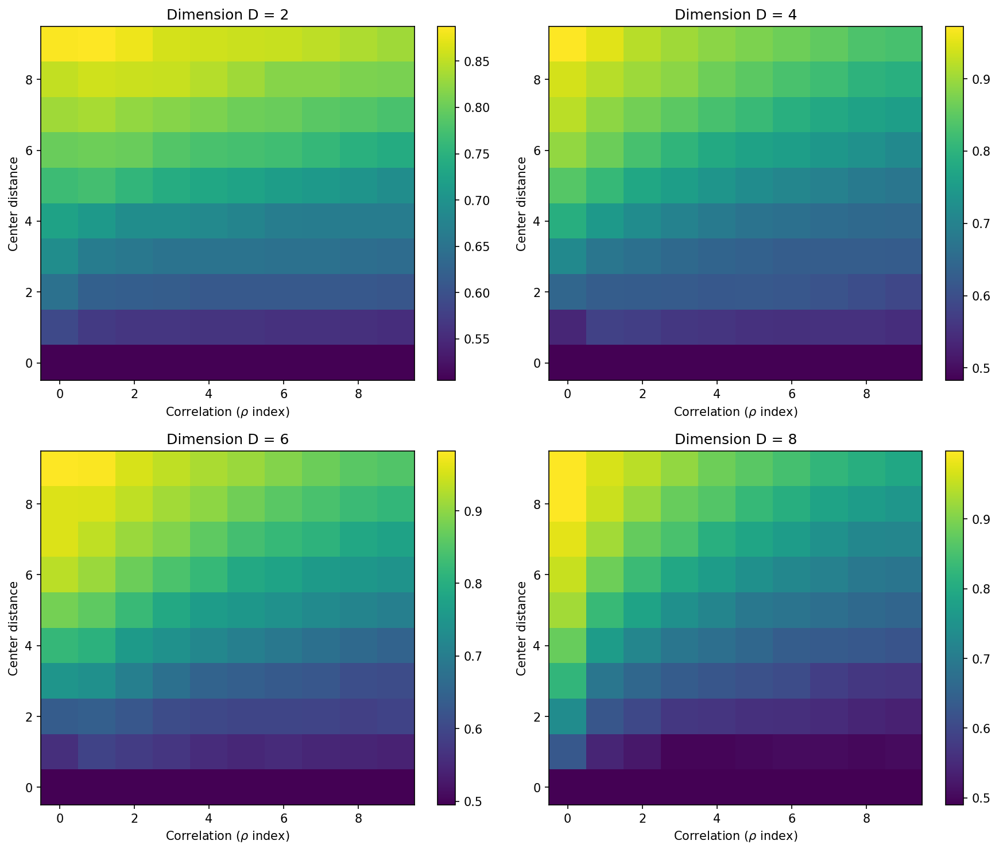
</p>

*Слева NB, справа QDA. Обе accuracy растут с увеличением сдвига центров и падают с ростом $`\rho`$; на глаз разница между ними мала, поэтому для сравнения и используется разность $`\mathrm{QDA}-\mathrm{NB}`$.*

### 2. Матрица Тёплица вместо равных $`\rho`$

**Условия.** Те же центры $`\pm m\,\mathbf 1`$, но $`\Sigma_{ij}=\rho^{\lvert i-j\rvert}`$.

**Результат.** При $`n=50`$–$`200`$ QDA уступает NB (по рисунку до примерно $`-0.1`$ при $`D=4`$–$`8`$), при $`n\ge 800`$ разница около нуля.

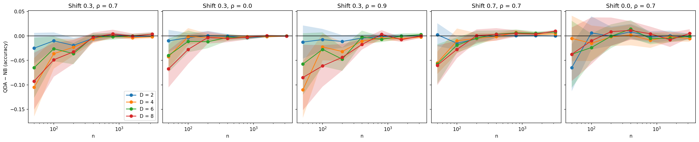

*$`\mathrm{QDA}-\mathrm{NB}`$ в зависимости от $`n`$ (логарифмическая ось). Колонки — пары (сдвиг, $`\rho`$): $`(0.3;\,0.7)`$, $`(0.3;\,0)`$, $`(0.3;\,0.9)`$, $`(0.7;\,0.7)`$, $`(0;\,0.7)`$; цвета — $`D`$; полосы $`\pm 2\,\mathrm{SE}`$.*

### 3. Сдвиг по одному признаку

Центры $`\pm c\,\mathbf e_k`$, остальные координаты нулевые ($`\mathbf e_k`$ — единичный вектор $`k`$-го признака).

**Равнокоррелированная $`\Sigma`$, сдвиг по первому признаку** (`diff_vs_n_e1_equi.png`). NB теряет до **0.24** ($`D=8`$, $`\rho=0.9`$, $`c=0.5`$, $`n=3200`$). Потеря не исчезает с ростом $`n`$, растёт с $`\rho`$ и с $`D`$; при $`\rho=0`$ равна нулю. Сравнение с теорией ($`\rho=0.9`$, $`c=0.5`$, $`n=3200`$):

| $`D`$ | 2 | 4 | 6 | 8 |
|---|---|---|---|---|
| симуляция $`\bar\Delta\pm\mathrm{SE}`$ | $`0.182\pm0.003`$ | $`0.219\pm0.004`$ | $`0.228\pm0.006`$ | $`0.241\pm0.008`$ |
| теория, $`n\to\infty`$ | 0.183 | 0.224 | 0.234 | 0.239 |

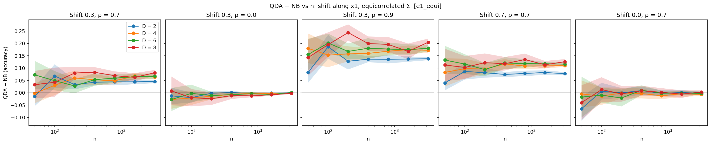

*Равнокоррелированная $`\Sigma`$, сдвиг по $`x_1`$. Колонки — (сдвиг, $`\rho`$): $`(0.3;\,0.7)`$, $`(0.3;\,0)`$, $`(0.3;\,0.9)`$, $`(0.7;\,0.7)`$, $`(0;\,0.7)`$; цвета — $`D`$. Разрыв не уходит к нулю с ростом $`n`$; при $`\rho=0`$ и при нулевом сдвиге разрыва нет. Значение 0.24 из текста (сдвиг 0.5) в этих панелях не показано: оно взято из массива `mean_diff_e1_equi.npy`.*

**Тёплиц, сдвиг по первому и по второму признаку.** При $`\rho=0.9`$, $`c=0.5`$ и $`n=3200`$:

| Сдвигается | $`D=2`$ | $`D=4`$ | $`D=6`$ | $`D=8`$ |
|---|---|---|---|---|
| первый признак (крайний) | 0.182 | 0.179 | 0.177 | 0.181 |
| второй признак (средний) | 0.183 | 0.244 | 0.241 | 0.247 |

Признаки у Тёплица неравноправны: диагональные элементы $`\Sigma^{-1}`$ у крайнего и у среднего признака разные (см. «Теория»), поэтому потери NB разные.

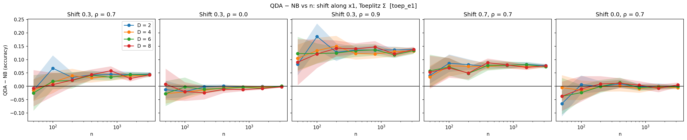

*Тёплиц, сдвиг по первому (крайнему) признаку; панели те же. Кривые для разных $`D`$ почти совпадают.*

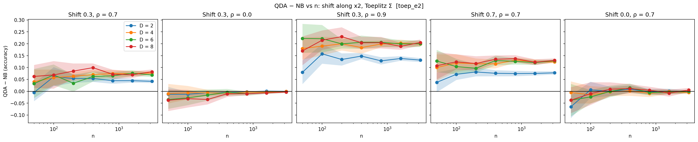

*Тёплиц, сдвиг по второму (среднему) признаку. При $`D\ge 4`$ потери заметно больше, чем в предыдущем рисунке, а при $`D=2`$ они такие же, потому что второй признак при $`D=2`$ тоже крайний.*

### 4. Угол сдвига относительно структуры $`\Sigma`$

Направление сдвига $`\mathbf d(\theta)`$ определено выше. Длина сдвига $`s`$ фиксирована (0.1, 0.3, 0.5, 0.7), $`\theta`$ от $`0^\circ`$ до $`90^\circ`$ с шагом $`15^\circ`$. На рисунках $`\rho=0.7`$.

**Равнокоррелированная $`\Sigma`$** (`main.py`):

- разрыв $`\mathrm{QDA}-\mathrm{NB}`$ имеет форму горба: у краёв он мал, максимум около $`45^\circ`$–$`60^\circ`$;
- при $`\rho=0.7`$, $`s=0.7`$, $`n=3200`$ максимум равен 0.078 ($`D=2`$), 0.126 ($`D=4`$), 0.148 ($`D=6`$), 0.167 ($`D=8`$);
- на краях при $`n=3200`$ и $`\rho=0.7`$: при $`\theta=0^\circ`$ разрыв от $`-0.009`$ до $`0`$, при $`\theta=90^\circ`$ от 0.001 до 0.027 (растёт с $`D`$ и убывает с ростом сдвига);
- наибольшее значение при $`n=3200`$ по всей сетке: **0.304** ($`D=8`$, $`s=0.7`$, $`\theta=45^\circ`$, $`\rho=0.9`$).

**Проверка теорией.** Контрольная клетка $`D=8`$, $`s=0.5`$, $`\theta=45^\circ`$, $`\rho=0.7`$, $`n=3200`$: теория (бесконечная выборка) 0.1341, симуляция $`0.1334\pm0.0035`$.

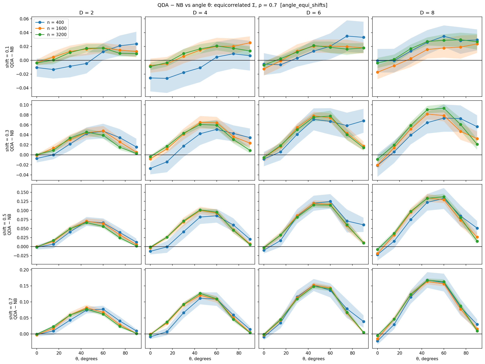

*Равнокоррелированная $`\Sigma`$, $`\rho=0.7`$. Строки — длина сдвига $`s=0.1;\,0.3;\,0.5;\,0.7`$, колонки — $`D`$, цвета — $`n=400,\,1600,\,3200`$; по горизонтали угол $`\theta`$. Полосы $`\pm 2\,\mathrm{SE}`$.*

**Тёплиц** (`degree_toeplitz.py`):

- та же форма горба; при $`\rho=0.7`$, $`s=0.7`$, $`n=3200`$ максимум около $`45^\circ`$ равен 0.078, 0.128, 0.145, 0.156 для $`D=2,4,6,8`$;
- при $`D=2`$ результаты совпадают с равнокоррелированным случаем (матрицы одинаковы);
- при $`D\ge 4`$ на $`\theta=90^\circ`$ остаётся разрыв 0.017–0.023, потому что $`\mathbf v`$ не является собственным направлением матрицы Тёплица.

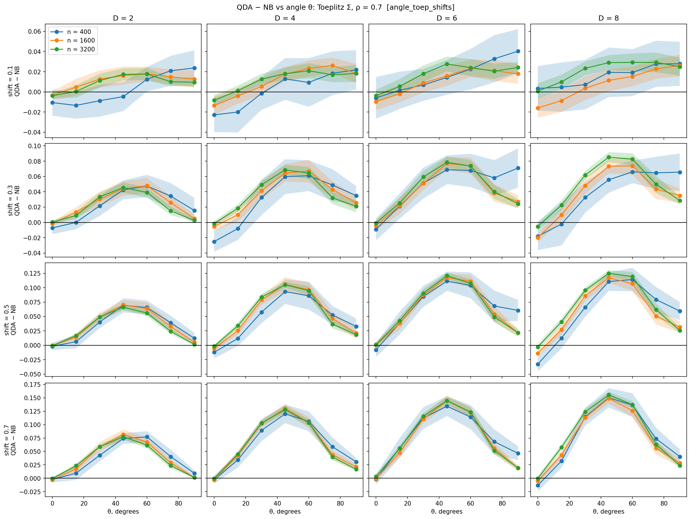

*Тёплиц, $`\rho=0.7`$; оси и обозначения те же.*

**Конечный $`n`$.** На $`\theta=90^\circ`$ при больших $`D`$ и $`\rho`$ разрыв положителен и убывает с ростом $`n`$ (шум оценки у NB); на малых углах при малом $`n`$ QDA платит за оценку ковариаций (отрицательный разрыв).

Более ранняя версия эксперимента с фиксированной длиной сдвига 0.3: `diff_vs_angle_angle_equi.png`.

### 5. Разные ковариации у классов ($`+\rho`$ против $`-\rho`$), средние одинаковые

`main_mod.py`. Классы различаются только знаком связей между соседними признаками, одиночные распределения признаков одинаковы.

- **NB:** accuracy около 0.5 при любых $`\rho`$, $`D`$ и $`n`$ (среднее по всей сетке 0.502).
- **QDA, $`n=3200`$, $`\rho=0.9`$:** $`D=2`$: 0.853 (теория $`\tfrac12+\tfrac1\pi\arcsin\rho=0.856`$); $`D=4`$: 0.931; $`D=6`$: 0.965; $`D=8`$: 0.983.
- QDA растёт с $`\rho`$ и с $`D`$; при малых $`n`$ отстаёт от своего предела, но уже при $`n=400`$ близок к нему.

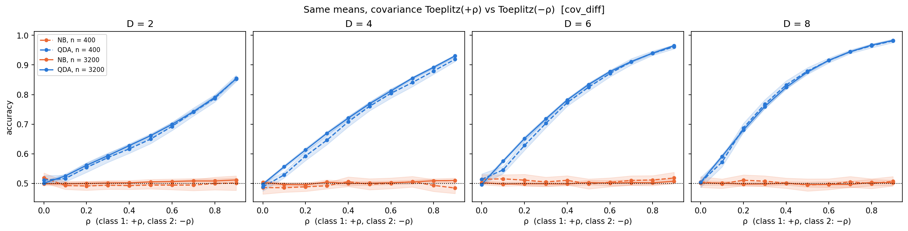

*Accuracy NB (оранжевый) и QDA (синий) в зависимости от $`\rho`$; пунктир — $`n=400`$, сплошная линия — $`n=3200`$, точечная линия — уровень 0.5; полосы $`\pm 2\,\mathrm{SE}`$.*

## Теория (кратко)

Пусть средние классов $`\pm\mathbf m`$, общая ковариация $`\Sigma`$, равные приоры, дисперсии признаков равны 1. При бесконечной выборке:

```math
\mathrm{acc}_{\mathrm{Bayes}}=\Phi\!\left(\sqrt{\mathbf m^{\top}\Sigma^{-1}\mathbf m}\right),\qquad
\mathrm{acc}_{\mathrm{NB}}=\Phi\!\left(\frac{\mathbf m^{\top}\mathbf m}{\sqrt{\mathbf m^{\top}\Sigma\,\mathbf m}}\right),
```

где $`\Phi`$ — функция распределения стандартного нормального. По неравенству Коши–Буняковского

```math
(\mathbf m^{\top}\mathbf m)^2\le(\mathbf m^{\top}\Sigma\,\mathbf m)(\mathbf m^{\top}\Sigma^{-1}\mathbf m),
```

причём равенство достигается тогда и только тогда, когда $`\mathbf m`$ — собственный вектор $`\Sigma`$. То есть разрыв $`\mathrm{acc}_{\mathrm{Bayes}}-\mathrm{acc}_{\mathrm{NB}}\ge 0`$ равен нулю ровно в этом случае.

**Сдвиг вдоль одного признака.** Для $`\mathbf m=c\,\mathbf e_k`$

```math
\mathrm{acc}_{\mathrm{Bayes}}-\mathrm{acc}_{\mathrm{NB}}=\Phi\!\left(c\sqrt{(\Sigma^{-1})_{kk}}\right)-\Phi(c).
```

- Матрица Тёплица $`\rho^{\lvert i-j\rvert}`$: $`\Sigma^{-1}`$ трёхдиагональна, $`(\Sigma^{-1})_{kk}=\dfrac{1}{1-\rho^2}`$ для крайнего признака и $`\dfrac{1+\rho^2}{1-\rho^2}`$ для среднего. При $`\rho=0.9`$, $`c=0.5`$ получаем 0.183 и 0.247, что совпадает с таблицей из раздела 3.
- Равнокоррелированная матрица: $`(\Sigma^{-1})_{kk}=\dfrac{1+(D-2)\rho}{(1-\rho)\,(1+(D-1)\rho)}`$; при $`\rho=0.9`$, $`c=0.5`$ это 0.183, 0.224, 0.234, 0.239 для $`D=2,4,6,8`$.

**Два класса с $`+\rho`$ и $`-\rho`$.** При $`D=2`$ и нулевых средних правило Байеса сводится к знаку $`x_1x_2`$, откуда

```math
\mathrm{acc}_{\mathrm{Bayes}}=\frac12+\frac1\pi\arcsin\rho .
```

## Как воспроизвести

```
pip install numpy matplotlib
python main.py              # углы, равнокоррелированная Σ (около 3 минут)
python degree_toeplitz.py   # углы, матрица Тёплица (около 3 минут)
python main_mod.py          # +ρ против −ρ (около 10 секунд)
```

Время указано по проверочному запуску на машине с двумя ядрами. Параметры (`correlations`, `dimensions`, `data`, `n_seeds`, `shifts_grid`, `degrees_grid`, `tag`) заданы в начале каждого скрипта. Скрипты сохраняют рисунки `.png` и массивы `.npy` (`mean_*` и `se_*`) в текущую папку; при запуске открывается окно `matplotlib` (в окружении без экрана задайте `MPLBACKEND=Agg`). В `main.py` и `degree_toeplitz.py` массивы сохраняются после `plt.show()`, то есть после закрытия окна рисунка.

Формы массивов:

- `mean_diff_angle_*.npy`: `(n, D, сдвиг, угол, ρ)`;
- `mean_diff_e1_equi.npy`, `mean_diff_toep_e1.npy`, `mean_diff_toep_e2.npy`: `(n, D, сдвиг, ρ)`, сдвиг = индекс/10;
- `mean_nb_cov_diff.npy`, `mean_qda_cov_diff.npy`: `(n, D, ρ)`, точности NB и QDA отдельно.

## Состав репозитория

| Файл | Что это |
|---|---|
| `main.py` | эксперимент «угол сдвига», равнокоррелированная Σ |
| `degree_toeplitz.py` | эксперимент «угол сдвига», матрица Тёплица |
| `main_mod.py` | эксперимент «разные ковариации» ($`+\rho`$ против $`-\rho`$) |
| `math.txt` | рабочий журнал: определения, гипотезы и выводы по этапам |
| `*.npy` | результаты прогонов (среднее и стандартная ошибка по сидам) |
| `*.png` | рисунки; соответствие эксперименту указано в разделах «Результаты» |

В репозитории лежат только текущие версии трёх скриптов эксперимента. Рисунки и массивы ранних этапов (`diff_heatmaps*`, `diff_vs_n_*`, `*-one-seed`, `Figure_1`, `mean_diff_e1_equi`, `mean_diff_toep_e1/e2`, `diff_vs_angle_angle_equi`) получены более ранними версиями кода и в виде отдельных скриптов здесь не представлены.

## Ограничения

- Только гауссовские данные, сбалансированные классы, $`D\le 8`$, два семейства матриц ковариации.
- 20 сидов; тест это 20% выборки, поэтому при $`n=50`$ на класс он состоит из 20 точек и шум велик. Здесь $`n`$ означает размер выборки на класс до разбиения: в обучение идёт около 80%.
- В скриптах NB считает дисперсию через `np.var` (делитель $`n`$), а QDA ковариацию через `np.cov` (делитель $`n-1`$); приоров у NB нет (при равных классах это не влияет на решение).
- Выбор вектора $`\mathbf v`$ в угловом эксперименте проверен на равнокоррелированной матрице (другой $`\mathbf v`$ с чередующимися знаками даёт тот же результат в пределах шума; этот прогон в репозиторий не входит); на матрице Тёплица $`\mathbf v`$ не проверялся.
- Объяснение шума NB на $`\theta=90^\circ`$ при больших $`D`$ и $`\rho`$ (шум оценки при коррелированных нерелевантных признаках) остаётся гипотезой: согласуется со спадом с ростом $`n`$, но прямо не доказано.
- Результаты немного различаются между машинами из-за разложения матрицы в `multivariate_normal`; побитовой воспроизводимости между машинами нет.

## Планы

- Перепрогон основных экспериментов с большой фиксированной тестовой выборкой и 100 сидами.
- Совмещённый эксперимент: сдвиг средних плюс разные ковариации у классов.
- Рисунок «теория против симуляции» для углового эксперимента и оформление теории для публикации.

## Связанные работы

- Domingos P., Pazzani M. On the Optimality of the Simple Bayesian Classifier under Zero-One Loss. Machine Learning, 29, 1997. [doi:10.1023/A:1007413511361](https://dx.doi.org/10.1023/A:1007413511361)
- Ng A. Y., Jordan M. I. On Discriminative vs. Generative Classifiers: A comparison of logistic regression and naive Bayes. NIPS 2001. [ссылка](https://papers.nips.cc/paper/2001/hash/7b7a53e239400a13bd6be6c91c4f6c4e-Abstract.html)
- Bickel P. J., Levina E. Some theory for Fisher's linear discriminant function, «naive Bayes», and some alternatives when there are many more variables than observations. Bernoulli, 10(6), 2004. [ссылка](https://projecteuclid.org/journals/bernoulli/volume-10/issue-6/Some-theory-for-Fishers-linear-discriminant-function-naive-Bayes-and/10.3150/bj/1106314847.full)
